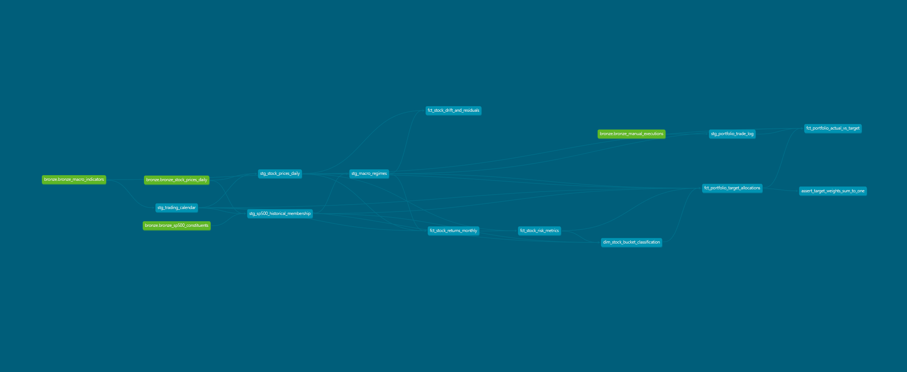
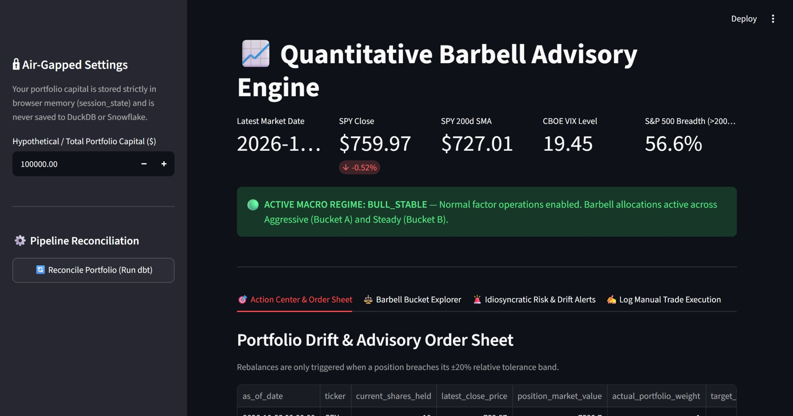
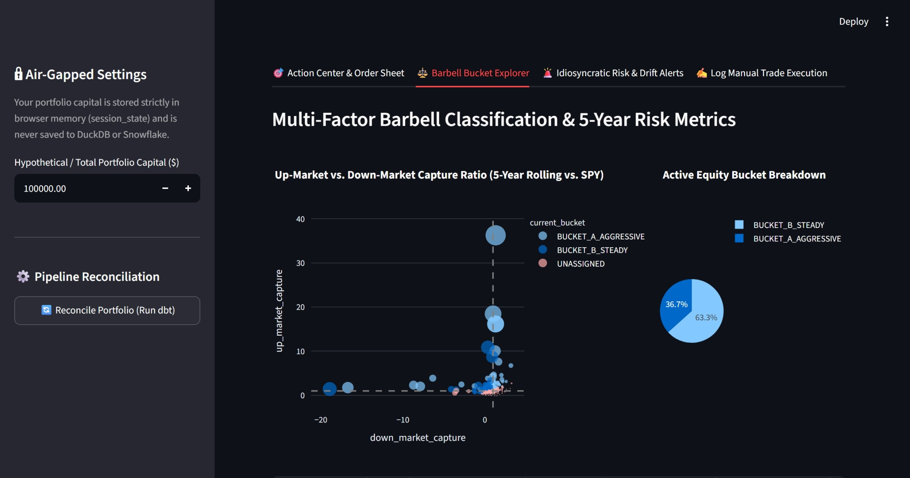

# Quantitative Barbell Advisory Engine v1.0

A production-grade, zero-cost local data engineering pipeline and quantitative advisory application built with **Python**, **dbt Core**, **DuckDB**, and **Streamlit**. Designed to showcase enterprise data engineering best practices, robust CI/CD, and multi-factor asset allocation without requiring paid cloud infrastructure during development.

---

## 🏛️ System Architecture & Medallion Design

The pipeline implements a strict **15-table Medallion Architecture** that models enterprise data warehouse standards entirely in-process using DuckDB.


```

[ Yahoo Finance API / Wikipedia ]
│
▼ (Python Ingestion Script)
┌────────────────────────────────────────────────────────┐
│ BRONZE LAYER (Raw Append-Only Source of Truth)         │
│  - bronze_stock_prices_daily                           │
│  - bronze_sp500_constituents                           │
│  - bronze_macro_indicators (SPY & ^VIX closes)         │
│  - bronze_manual_executions                            │
└────────────────────────────────────────────────────────┘
│
▼ (dbt Silver Layer - Cleaning & Calendar Normalization)
┌────────────────────────────────────────────────────────┐
│ SILVER LAYER (Staging & Conformed Dimensions)          │
│  - stg_trading_calendar (Dense daily exchange spine)   │
│  - stg_stock_prices_daily (Split/dividend adjusted)    │
│  - stg_sp500_historical_membership (Point-in-Time)     │
│  - stg_macro_regimes (Market breadth & 200d SMA)       │
│  - stg_portfolio_trade_log                             │
└────────────────────────────────────────────────────────┘
│
▼ (dbt Gold Layer - Feature Store & Portfolio Marts)
┌────────────────────────────────────────────────────────┐
│ GOLD LAYER (Business Logic & Analytical Marts)         │
│  - fct_stock_returns_monthly                           │
│  - fct_stock_risk_metrics (Sortino, Max DD, Semi-dev) │
│  - fct_stock_drift_and_residuals (Rolling 90d Beta/Z)  │
│  - dim_stock_bucket_classification (Hysteresis Bands)  │
│  - fct_portfolio_target_allocations (Risk Parity)      │
│  - fct_portfolio_actual_vs_target (Drift & Orders)     │
└────────────────────────────────────────────────────────┘
│
▼
┌────────────────────────────────────────────────────────┐
│ STREAMLIT ADVISORY APPLICATION                         │
│  - Macro Circuit-Breaker Banners                       │
│  - Barbell Bucket Explorer (Plotly Scatter / Pie)      │
│  - Action Center & CSV Export Order Sheet              │
│  - Append-Only Manual Trade Execution Logger           │
└────────────────────────────────────────────────────────┘

```

---

## 📊 Interactive Lineage & UI Previews

> *The interactive dbt lineage graph and Streamlit advisory dashboards:*

* **dbt Data Lineage DAG (15 Models):**
  

* **Streamlit Action Center & Order Sheet:**
  

* **Barbell Bucket Explorer (Capture Ratio Scatter):**
  

---

## 🔬 Quantitative Strategy & Methodology

The application employs a **multi-factor barbell strategy** balancing an aggressive growth factor against a low-volatility quality factor, benchmarked against the tradable ETF **SPY**:
* **Downside Risk Efficiency:** Utilizes **Downside Semi-Deviation** and the **Sortino Ratio** rather than standard deviation, penalizing only negative variance below SPY's return.
* **Capture Ratios:** Categorizes equities by their Up-Market (>120% target for growth) and Down-Market (<80% target for steady compounders) capture relative to SPY.
* **Idiosyncratic Anomaly Detection:** Tracks rolling 90-day regression residuals ($\epsilon$) and triggers structural alerts when a stock's Z-score drops below $-3.0$, isolating company-specific distress from macro pullbacks.
* **Macro Circuit Breakers:** Monitors market breadth (% of S&P 500 stocks above 200-day SMA) and the CBOE Volatility Index (VIX) to pause aggressive rebalancing during systemic panic regimes.
* **Risk-Parity Allocation:** Sizes positions inversely to their downside volatility while enforcing strict sector allocation caps ($\pm 5\%$ relative to SPY) and pairwise correlation clustering ($\rho \le 0.75$).

---

## 🛠️ Tech Stack & Engineering Best Practices

* **Orchestration & Transformation:** dbt Core (`dbt-duckdb`) with automated schema generation macros and singular tests (e.g., `assert_target_weights_sum_to_one`).
* **Data Storage & Compute:** DuckDB (local in-process columnar OLAP database providing sub-second analytical performance across millions of rows).
* **Application Framework:** Streamlit (featuring dual-engine read/write adapters, air-gapped personal net worth calculation in `st.session_state`, and CSV order exports).
* **Code Quality & Linting:** Ruff (Python formatting/linting) and SQLFluff (`duckdb` dialect with in-memory `jinja` templating) enforced via local Git `pre-commit` hooks.
* **CI/CD Pipeline:** GitHub Actions continuous integration running automated lint checks, mock Bronze database seeding, and complete `dbt build` integration tests on every push and Pull Request.

---

## 🚀 Quickstart: Clone & Run Locally

You can spin up and execute the entire 15-table data pipeline and interactive advisory dashboard on your local machine in under 3 minutes for **$0**:

### 1. Clone the Repository
```powershell
git clone [https://github.com/your-username/stock-investment-app.git](https://github.com/your-username/stock-investment-app.git)
cd stock-investment-app

```

### 2. Set Up Python Virtual Environment

```powershell
python -m venv venv
# On Windows:
.\venv\Scripts\Activate.ps1
# On macOS / Linux:
source venv/bin/activate

pip install --upgrade pip
pip install -r requirements.txt

```

### 3. Run Bronze Ingestion (Choose Quickstart Sample or Full S&P 500)

```powershell
# Option A: Fast quickstart ingestion (first 30 S&P 500 tickers)
python scripts/ingest_bronze_local.py --sample 30

# Option B: Full S&P 500 historical ingestion (~3.2 million daily rows)
python scripts/ingest_bronze_local.py --full

```

### 4. Build and Test dbt Medallion Models

```powershell
dbt build --project-dir dbt_stock_project --profiles-dir dbt_stock_project

```

### 5. Launch the Streamlit Advisory Application

```powershell
streamlit run streamlit_app/app.py

```

*(Your browser will automatically open to `http://localhost:8501`).*

---

## 💰 Cloud FinOps & Cost-Control Architecture

A core architectural principle of this repository is **zero-cost local development mirroring cloud production**:

* **Columnar Parity:** DuckDB shares the exact same columnar OLAP storage format and standard ANSI SQL window function dialect as Snowflake. This allows complex regression, semi-deviation, and rolling matrix queries to be developed, tested, and optimized locally on multi-core hardware before spending a single dollar on cloud compute.
* **Seamless Multi-Targeting:** By simply updating target outputs in `profiles.yml`, the identical dbt model definitions execute natively against Snowflake in production.
* **CI Efficiency:** GitHub Actions utilizes a lightweight, deterministic mock seeder (`scripts/seed_ci_mock_data.py`) to validate all 15 models and data quality tests in CI without hitting external API rate limits or incurring cloud warehousing costs.

---

## ⚖️ License & Educational Disclaimer

* **License:** Distributed under the **MIT License**. See `LICENSE` for details.
* **Disclaimer:** This application is strictly an educational data engineering and quantitative analytics showcase. It operates as an advisory decision-support tool and does not constitute formal financial or investment advice.
